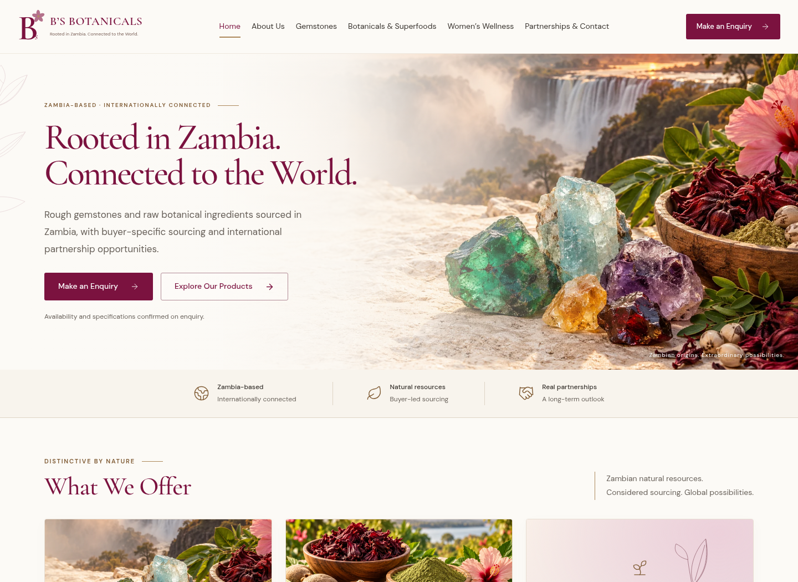

# B’s Botanicals

A responsive, six-page website for **B’s Botanicals & Naturals Limited**, built with React, Vite and a small optional Node email service. The visual direction follows the supplied ivory, burgundy, botanical and gemstone references. The October 2026 revised PDF provides the content and sourcing qualifications.

## Website screenshots

These are screenshots of the built website, viewable directly on GitHub. The website has not yet been publicly deployed.



[Full desktop screenshot](docs/previews/desktop-full.png) · [Full mobile screenshot](docs/previews/mobile-full.png)

[Gemstone browsing](docs/previews/gemstones.png) · [Enquiry form](docs/previews/enquiry-form.png) · [Mobile wellness concepts](docs/previews/wellness-mobile.png)

## Interface improvements

- Readable 16–17px main copy, 14px desktop navigation, stronger contrast and larger tap targets.
- A two-line desktop hero and a mobile enquiry action visible in the first screen.
- A simpler homepage with repeated product sections removed, plus a clear sourcing process.
- Searchable gemstone cards and botanical search with ingredient-group filters, result counts and empty-state recovery.
- Product-specific enquiry links that go straight to a prefilled form, with a visible product summary.
- Inline form validation, keyboard focus management, duplicate-send prevention and an email fallback when direct delivery fails.
- A mobile menu with focus containment, Escape dismissal and scroll restoration; wellness concepts use readable two-column cards on phones.
- A sourcing-information section explaining availability, documentation and delivery discussions without adding unverified claims.

Original logo, packaging and sourcing photographs still need to be supplied. Direct email delivery still requires real email settings and a reviewed Privacy Notice. See [asset handoff instructions](docs/ASSET_HANDOFF.md).

## Run locally

Use Node **22.12+ or 24 LTS** and npm. In this checkout:

```sh
npm ci
npm run dev
```

The development server uses port **5173**, with the enquiry API integrated into Vite. No credentials, database, external font requests or paid services are needed for the preview.

```sh
npm run build       # Optimized production files in dist/
npm start           # Production Node server, default port 3000
npm test            # API validation, origin checks, gating, failure and rate-limit tests
npm run test:e2e    # Desktop/mobile browser and automated accessibility checks
```

This revision passed seven API tests and 34 desktop/mobile browser tests against the production server, including automated accessibility checks on all seven routes. An additional 42 production layout checks covered 320, 640, 768, 1024, 1280 and 1440px widths. Real inbox delivery remains unverified.

Set `PLAYWRIGHT_BASE_URL` to a running production server to exercise that build; otherwise browser tests start or reuse the Vite development server.

Browser tests use the installed `/usr/bin/chromium`. On another machine, set `CHROMIUM_PATH` to your browser executable. The cloud machine already provides Chromium.

## Pages and behaviour

| URL | Content |
| --- | --- |
| `/` | Hero, three sourcing areas, company introduction, collection, process and FAQs |
| `/about` | Company story and approach to business |
| `/gemstones` | Six searchable rough gemstone sourcing interests and other Zambian gemstones |
| `/botanicals` | Eight searchable raw botanical sourcing categories, ingredient-group filters, forms and applications |
| `/womens-wellness` | Five planned concepts, all clearly in development |
| `/contact` | Four required fields, optional commercial details and direct contact information |
| `/privacy` | Honest preview information; displays the reviewed notice when one is configured |

Category CTAs preselect the enquiry type. Individual product links also prefill the product. The mobile menu, product search and filters, FAQ accordion, form validation, email draft editing and 404 recovery work without external services. Fonts and images are served locally. No analytics or marketing cookies are installed.

## Enquiries: working preview and production delivery

**Default mode works without sending visitor information to the server.** A visitor enters four required fields, prepares a draft, and opens it in their own email application or copies the text. The interface explicitly says the enquiry has not yet been sent. Information stays in React memory and is not saved in browser storage. The email application must be configured on the visitor’s device; copying is the alternative.

The optional direct-send endpoint is included but disabled by default. To activate it:

1. Deploy the Node server behind HTTPS. A static-only host can serve the frontend, but cannot run the SMTP endpoint.
2. Configure a real SMTP provider and verified sender using the names in `.env.example`. Store values in the hosting platform’s secret settings or an ignored `.env`, never in client variables or source control. SMTP requires TLS; verification is not disabled.
3. Obtain a reviewed Privacy Notice reflecting the actual hosting, email processing, retention, rights and international transfers. Store the notice as UTF-8 plain text in a private server file, and set `PRIVACY_NOTICE_PATH` to its absolute path.
4. Set `PRIVACY_REVIEWED=true`, restart the server, and verify `/api/config` reports `deliveryAvailable: true` and returns the intended public notice. The `/privacy` page displays that text.
5. Send a real test enquiry and confirm receipt at **info@bs-botanicals.com** before public launch. API tests simulate mail acceptance and failure; they do not establish real inbox delivery.

The server validates fields, limits request size, checks the browser origin, rate limits submissions, and only returns success after SMTP acceptance. Success means the provider accepted the mail, not a guarantee of inbox placement. The in-memory limiter is suitable for a single process; configure shared rate limiting at your hosting edge if scaling horizontally. Preserve the original Host header when reverse proxying. No personal enquiry data is logged by the application; configure appropriate hosting log retention separately.

## Launch items still requiring owner input

- **Official logo and approved five-tea packaging photo:** the originals were not attached as separate files. The wordmark is a custom reconstruction; tea artwork consists of concept panels, not fabricated product packaging. Replace these with approved originals before final brand sign-off.
- **Prior conversations:** the linked conversation-reading tool was unavailable in this session. Implementation uses the uploaded PDF and the three visible visual references; assets from those threads could not be recovered.
- **Founder names:** the PDF marks public display as pending confirmation. The About page contains the company story without publishing unconfirmed personal details.
- **Tea wording:** the five concepts use the revised PDF labels, carry development notices, and make no medical or efficacy promises. Obtain the indicated review before public release.
- **Privacy and direct mail:** activate only through the tested configuration above. The preview notice is not presented as a reviewed legal policy.
- **Deployment:** domain/DNS, HTTPS, hosting and real mail delivery have not been configured or verified. The website is created and tested locally, not publicly deployed.
- **Search indexing:** this unpublished preview deliberately has site-wide `noindex, nofollow` in `index.html` and `Disallow: /` in `public/robots.txt`. After content and legal approval, remove both preview restrictions, make the owner’s indexing decision for Women’s Wellness, and add the final domain’s canonical/social image URLs and sitemap.

## Editing and assets

- `src/pages/`: page layouts and content.
- `src/data.js`: navigation, product lists, FAQs, concepts and search metadata.
- `src/content/assets.js`: central registry for replacing illustrative artwork with approved assets.
- `src/components/ProductPortfolio.jsx`: search, filters, product illustrations and prefilled enquiry links.
- `src/components/ui.jsx`: reusable identity, decorations, buttons and shared sections.
- `src/styles.css`: design system and responsive layouts.
- `public/images/`: optimized illustrative WebP images; see `ASSETS.md` for provenance.
- `server/`: optional API and production static server.
- `tests/`: API and browser coverage.

The production Node server supports direct navigation to page routes. For static hosting, configure a history fallback to `index.html` (a `_redirects` file is supplied for hosts that support that format). The frontend gracefully stays in email-draft mode when the API is unavailable. `npm run preview` is only a frontend build preview; use `npm start` to exercise the production API.

Cloud tasks are already isolated. Continue in the existing checkout; do not create a Git worktree unless the user requests one. Do not assume live processes survive environment publication or restart.
